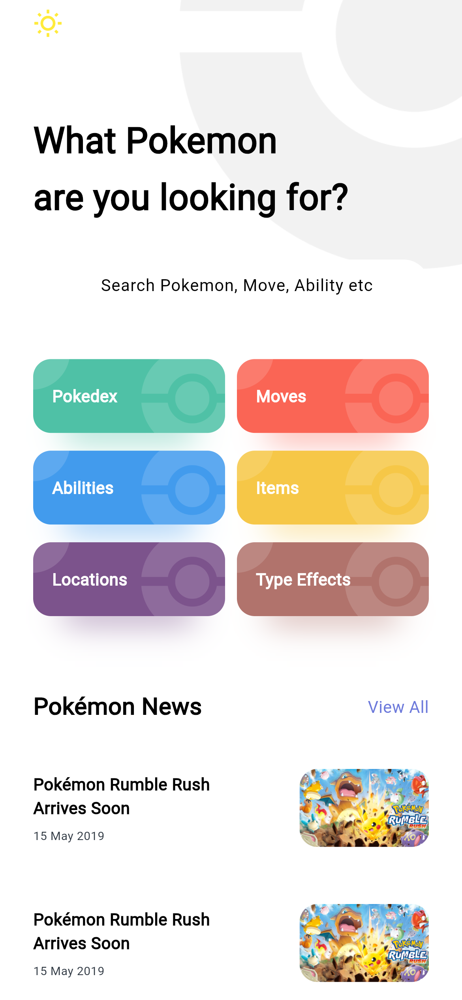
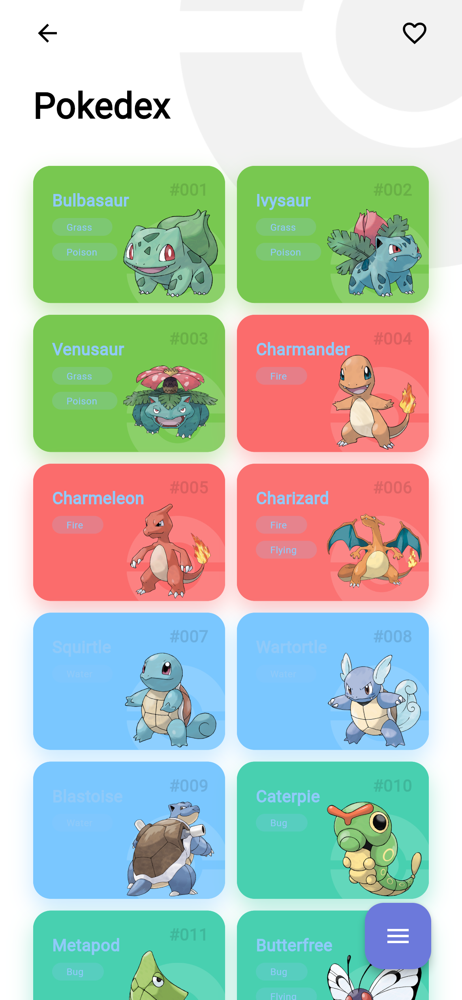
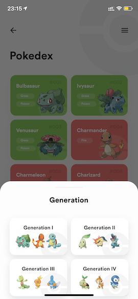
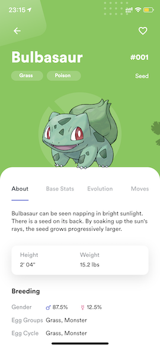
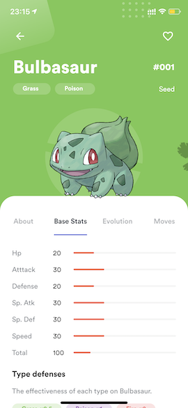
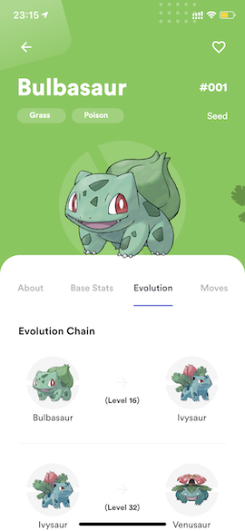

# Flutter Pokedex

An animated Pokedex built with Flutter and Clean Architecture. Browse Pokemon by generation, view stats, evolutions and details, with offline caching.

## Screenshots

| Home | Pokedex |
| --- | --- |
|  |  |

Home and Pokedex are from the current build (web build at phone size). More screens:

| Generation filter | Pokemon info | Base stats | Evolution |
| --- | --- | --- | --- |
|  |  |  |  |

## Features

- Pokemon list with generation filter
- Detail screen with About, Base Stats and Evolution tabs
- Sliding-up info panel and many custom animations
- News feed on the home screen
- Light and dark theme toggle
- Cached network data for fast reloads and offline use
- Responsive web frame support

## Tech stack

| Area | Technology |
| --- | --- |
| Framework | Flutter, Dart |
| Architecture | Clean Architecture: `data` / `domain` / `ui` layers |
| State management | Bloc (`flutter_bloc`), in `states/` |
| Networking | Dio with `dio_cache_interceptor` |
| Local storage | Hive |
| UI | sliding_up_panel, cached_network_image, flutter_web_frame |

## Project structure

```
lib/
├── app.dart, main.dart, routes.dart
├── configs/
├── core/
├── data/       # API + local data sources, repositories impl
├── domain/     # entities, repository contracts
├── states/     # Bloc state management
├── ui/         # screens, modals, widgets
└── utils/
```

## Getting started

```bash
git clone https://github.com/eslamahmedfahmy/pokedex_app.git
cd pokedex_app
flutter pub get
flutter run
```

## Credits

Based on the open-source Flutter Pokedex by Pham Sy Hung (MIT License, see [LICENSE](LICENSE)). The Pokemon list and item data are loaded from the author's public GitHub gists. Pokemon names and artwork belong to their owners.

## Author

**Eslam Fahmy** · [LinkedIn](https://www.linkedin.com/in/eslam-ahmed-fahmy-340220202)
